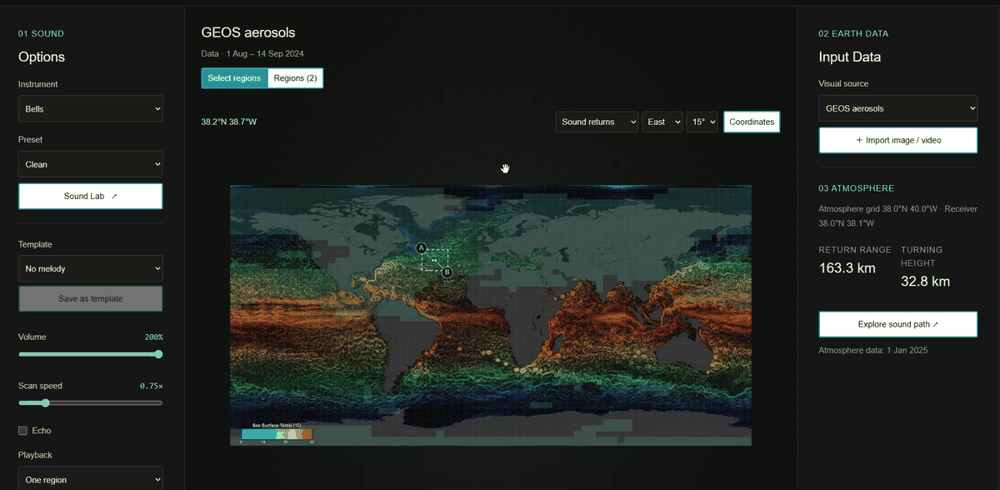
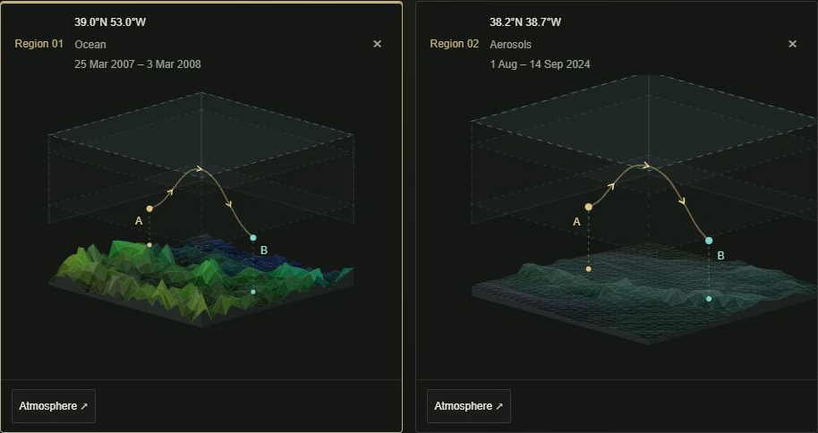

# Earth / Resonance

Cosmic Siblings: Hoi Wen Han and Hoi Shao Xuan Crystal.

Turn the changing colors of NASA ocean and aerosol imagery into music. Select regions, choose an instrument, and explore a simulated sound path through the atmosphere.

**[Open the app](https://earth-resonance.onrender.com/)** · **[Sources & method](https://docs.google.com/document/d/1Vn3WamhG3qnero-J41rTn5YZQ7JGvrADSxbjdclOmkw/view)**

## Try it

Select a region, then press **Play**. Silent demo:

Compare regions and adjust the sound in Sound Lab.

## Hear examples

Short scans of saved frames, with Echo and effects off. Download a WAV to listen.

- [Ocean · Bells](docs/media/ocean-bells.wav?raw=true)
- [Ocean · Soft synth](docs/media/ocean-soft-synth.wav?raw=true)
- [Aerosols · Orchestral](docs/media/aerosols-orchestral.wav?raw=true)

Sounds are synthesized. Surface peaks show image brightness, not terrain. Dataset dates, credits and model limits are in [Sources & method](https://docs.google.com/document/d/1Vn3WamhG3qnero-J41rTn5YZQ7JGvrADSxbjdclOmkw/view), which anyone can read.

[Development and hosting](docs/DEVELOPMENT.md)
