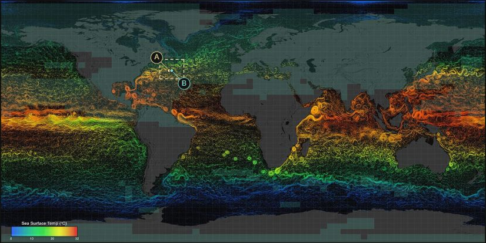
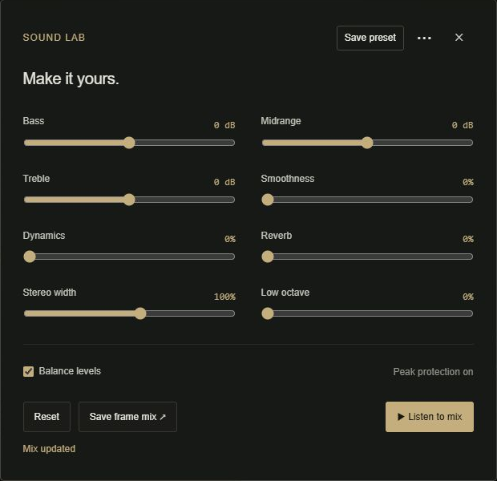
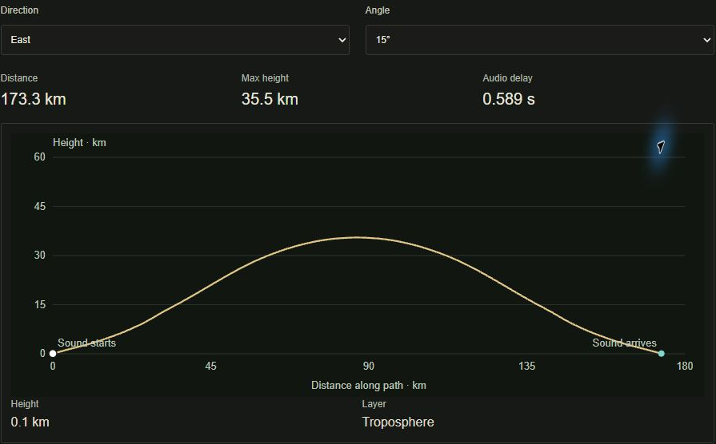

# Earth / Resonance

Cosmic Siblings: Hoi Wen Han and Hoi Shao Xuan Crystal.

Pick a patch of NASA ocean or aerosol imagery and hear its colors as musical notes. A moving scan line shows the pixels being played. Compare saved regions, play them in order or together, and shape the sound in Sound Lab. A separate atmosphere model shows how temperature and wind can bend a sound path.

## See the app

Choose a region on the map. Its changing colors become musical notes.



Compare places side by side. The peaks represent image brightness, not mountains.


<details>
<summary>Sound Lab and atmosphere views</summary>

Adjust bass, treble and smoothness, then save your favorite settings.



Explore how temperature and wind bend the modeled sound path from A to a different location, B.



</details>

## Hear examples

Download a WAV file and open it in your audio player. Each example is a 4.5-second scan of a saved NASA visualization frame, generated with the app's current sound engine at 1× scan speed. Echo and effects are off. In the app, the video keeps changing while you listen.

| Example | Audio |
| --- | --- |
| Ocean with bells | [Download WAV](docs/media/ocean-bells.wav?raw=true) |
| Same ocean patch with soft synth | [Download WAV](docs/media/ocean-soft-synth.wav?raw=true) |
| Aerosols with a synthesized orchestral voice | [Download WAV](docs/media/aerosols-orchestral.wav?raw=true) |

These are synthesized interpretations, not recordings of Earth. [Sample settings and source hashes](docs/media/audio-settings.json) document the inputs. Ocean imagery: [NASA SVS / ECCO2](https://svs.gsfc.nasa.gov/3912/). Aerosol imagery: [NASA SVS / GMAO](https://svs.gsfc.nasa.gov/5572/). Screenshots show this app using those visualizations.

## Run locally

Use Python 3.11 or 3.12. No AI checkpoint or GPU is needed.

```powershell
python -m venv .venv
.venv\Scripts\python -m pip install -r requirements.txt
.venv\Scripts\python server.py
```

Open http://127.0.0.1:8766/. On Windows, `Open Sound Lab.cmd` can launch the configured environment. The first new atmospheric selection needs internet access to the public GEOS-Chem archive; subsequent requests use a local cache. Keep the server local.

## What the controls do

- In order scans each checked region once, then moves to the next.
- Together mixes checked regions at the same time.
- Melody uses assigned notes; imagery changes their tone and loudness.
- Listen follows the selected node mode in Regions view. On the map it plays the current selection.
- Repeat nodes repeats a node sequence. Echo adds an optional modeled delayed arrival.
- Scan speed changes image-scanning speed. Melody tempo is separate.
- Saved regions, scan speed, templates and Echo preference stay in that browser and site address.

## Data and interpretation

- Ocean: NASA SVS 3912 / ECCO2, 25 March 2007 to 3 March 2008.
- Aerosols: NASA SVS 5572 / GEOS, 1 August to 14 September 2024.
- Atmosphere: NASA MERRA-2, regridded by GEOS-Chem, 1 January 2025 at 01:30 UTC; coarse 4 by 5 degree cells.

Imagery dates and atmospheric dates differ. Surface height represents image brightness, not real terrain. Sounds are synthesized, not recordings of Earth. The simplified atmospheric ray model is educational; arrival playback compresses travel time by 1,000 and is not a validated audible-sound simulation. Ocean month labels are approximate. Read Sources & method in the app and `dist/assets/provenance.json` for credits and limitations.

The short Sweden practice preset credits C418 / Daniel Rosenfeld and a publisher score preview. It is a separate composed example, not NASA-derived melody or a full song. No rights to the composition are claimed.

## Repository layout

`dist/` contains the current browser app, embedded imagery and calculated example profiles. Python files provide geographic profile lookup and ray calculations. `data/` holds the vertical grid and source metadata. `docs/media/` contains the README screenshots and short audio examples. Large duplicate source movies, old model experiments, logs and other generated audio are excluded. The embedded JavaScript media bundles are included so a clone can display the imagery.

`build_demo.py --data-only` rebuilds the example profiles. Historical audio-export mode and source-media preparation require the separate research workspace and are not needed to run this app.

## Checks

With Node.js installed:

```powershell
node verify_music_nodes.cjs
node verify_region_group.cjs
node verify_node_melody.cjs
node verify_echo.cjs
node verify_saved_regions.cjs
```

## Team workflow

Wen Han uses `main` for functions; Crystal uses `ui-crystal` for interface work. See [COLLABORATION.md](COLLABORATION.md).

The initial commits import an already-developed app in component groups. The push/pull exercise uses today's actual operations; it does not reconstruct past development or claim that either contributor individually wrote all imported code. AI assistance was used in implementation and documentation.
